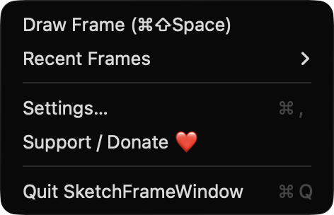
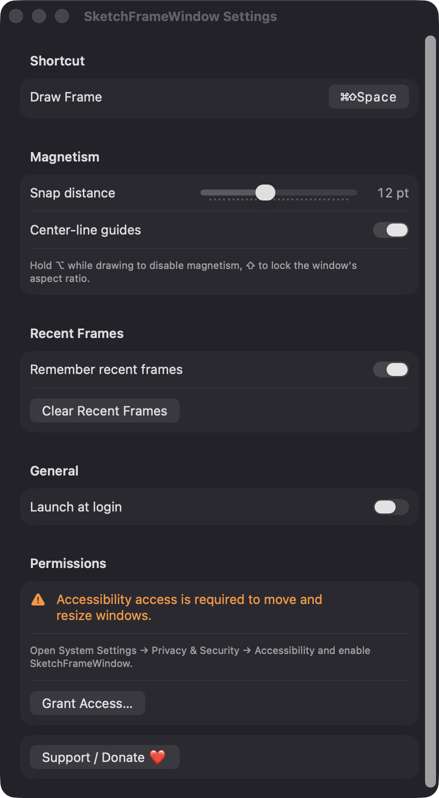

# SketchFrameWindow

**🌐 Website:** [turhe123.github.io/sketch-frame-window](https://turhe123.github.io/sketch-frame-window/)

Press a hotkey, drag a freehand rectangle anywhere on screen, and your window fits that exact frame.

> 🆓 A free, open-source **Lasso alternative** for macOS 14+. Native Swift, no accounts, no subscriptions, MIT licensed.


## Why

SketchFrameWindow is a free, open-source, 100% native, backend-free alternative to paid utilities in the *Window Management* category. It was inspired by Lasso ($9.99 one-time), which showed how pleasant it is to size a window by dragging instead of memorizing layout shortcuts. SketchFrameWindow takes a slightly different route: a free-form rectangle with soft magnetic edges instead of a fixed grid. It has no servers, no accounts, and no network code.

## Features

- **Global hotkey** (default `⌘⇧Space`, rebindable in Settings) toggles a dimmed overlay over every display.
- **Freehand rectangle**: drag anywhere; on release, the window that was frontmost when you pressed the hotkey is moved and resized to that exact frame.
- **Live size label** showing the rectangle in points and as a percentage of the screen's visible area.
- **Magnetic snapping** to screen edges, thirds, and (optionally) center lines. The snap distance is adjustable from 0 to 30 pt (default 12). Hold `⌥` to turn magnetism off.
- **Aspect-ratio lock**: hold `⇧` to keep the window's original aspect ratio.
- **Multi-display**: draw on any screen and the window lands on that screen.
- **Recent frames**: the last five frames are stored as percentages, so they work across screen sizes. Press `1`–`5` in the overlay, or pick one from the menu bar's *Recent Frames* submenu. They can be turned off or cleared in Settings.
- **Safe edge cases**: drags smaller than 100 pt are ignored. If a window refuses the exact size because of its own min/max limits, it's centered in the drawn rectangle. Full-screen windows are skipped. The overlay is dismissed if displays change. `Esc` cancels.
- **Menu bar app** (no Dock icon) with Draw Frame, Recent Frames, Settings, Support, and Quit.
- **Launch at login** via `SMAppService`.

## Screenshots

<p align="center"></p>

<p align="center"><em>The menu bar dropdown: start Draw Frame with ⌘⇧Space, recall Recent Frames, open Settings, or support the project.</em></p>

<p align="center"></p>

<p align="center"><em>Settings let you rebind the hotkey, tune magnetic snapping and center-line guides, manage recent frames, launch at login, and check Accessibility access.</em></p>

## Install

1. Download `SketchFrameWindow-macOS.zip` from the [latest release](https://github.com/turhe123/sketch-frame-window/releases/latest).
2. Unzip it and move `SketchFrameWindow.app` to `/Applications`.
3. The app is open source and not notarized, so clear the quarantine flag:

   ```bash
   xattr -cr /Applications/SketchFrameWindow.app
   ```

4. The first time, right-click the app → **Open**.

## Build from source

Requires Xcode with macOS 14+ SDK and [XcodeGen](https://github.com/yonaskolb/XcodeGen).

```bash
brew install xcodegen
xcodegen generate
xcodebuild -project SketchFrameWindow.xcodeproj -scheme SketchFrameWindow -configuration Release -derivedDataPath ./build build
```

The app is produced at `build/Build/Products/Release/SketchFrameWindow.app`.

## Permissions

- **Accessibility** (required): used to find the focused window and to move and resize it through the Accessibility API. The app asks on launch; you can also grant it from Settings → Permissions, or in System Settings → Privacy & Security → Accessibility.

That is the only permission the app requests. It does **not** ask for Screen Recording, Microphone, Camera, or network access; the overlay is drawn by the app itself and never captures your screen.

## Support ❤️

SketchFrameWindow is free and always will be. If it saves you time, you can support its development:

[Support Or (Leo) Davidai ❤️ on Ko-fi](https://ko-fi.com/leodavidai)

## More free Mac apps

SketchFrameWindow is one of [60 free, open-source Mac utilities](https://github.com/turhe123/mac-apps) built the same way: native Swift, no accounts, no telemetry. Browse the full gallery at [turhe123.github.io/mac-apps](https://turhe123.github.io/mac-apps/).

## License

MIT © Or Davidai Bachar
